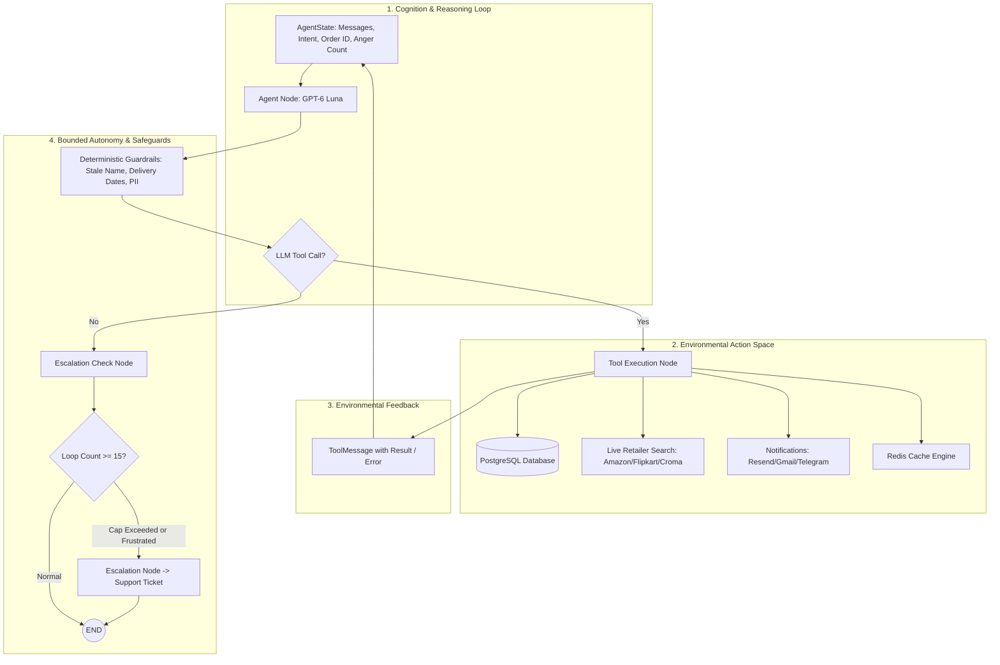

# Why This Application Is Agentic: Architectural Deep Dive & Design Patterns

## 1. Executive Summary

In contemporary artificial intelligence engineering, the term **"Agentic"** distinguishes systems capable of **autonomous reasoning, environmental observation, tool-directed action, and goal-directed self-correction** from traditional rule-based programs, static prompt-completion APIs, or rigid linear LLM pipelines (such as standard RAG chains).

The **LangGraph E-commerce Customer Support Agent** is fundamentally built as an **Agentic AI System**. It does not simply generate passive text responses; it acts as an autonomous software agent endowed with:
- **Perception**: Consuming multi-modal user inputs (text and transcribed speech) along with multi-turn session state.
- **Cognition & Planning**: Analyzing intent, breaking down complex multi-step objectives, and determining *which* actions are needed without hardcoded branching.
- **Action (Agency)**: Executing real-world side effects through structured tools (database queries, transactional updates, multi-platform web searches, email dispatch, and Telegram alerts).
- **Feedback & Reflection**: Ingesting the outputs of its own actions, observing the results, and dynamically deciding next steps in an iterative loop.
- **Bounded Autonomy & Guardrails**: Enforcing strict business logic, safety invariants, loop boundaries, and sentiment-triggered human escalations.

---

## 2. Agentic AI vs. Alternative Paradigms

To understand why this architecture is agentic, consider how different paradigms would handle a request like:  
> *"Hi, my name is Shin. I'm in the UK and I want to buy a Sony BRAVIA 4K TV."*

| Architectural Dimension | Traditional Rule Engine / Chatbot | Linear LLM Chain (e.g., Simple RAG) | **This Agentic Application (LangGraph ReAct)** |
| :--- | :--- | :--- | :--- |
| **Control Flow** | Fixed `if/else` decision trees and pre-scripted intent regexes. | Fixed sequence: `Prompt -> Retrieve -> Format -> Output`. | **Dynamic directed graph** where the LLM chooses tools and routes iteratively. |
| **Tool Usage** | Hard-coded API calls strictly mapped 1:1 to intents. | Single retrieval step injected into prompt before generation. | **Autonomous tool invocation**: The LLM determines tool names, arguments, and parallel execution dynamically. |
| **Feedback Loop** | None; if a branch fails, fallback to default error message. | None; single forward-pass completion. | **Closed-loop reflection**: Tool execution results (`ToolMessage`) cycle back into the LLM context to inform the next thought. |
| **State Management** | Session dictionary with static slots. | Ephemeral or append-only message list. | **Graph-level state machine (`AgentState`)** with checkpointing, message pruning, and memory persistence. |
| **Error Handling** | Hard crashes or generic script fallbacks. | Hallucinates plausible-sounding explanations. | **Autonomous recovery & fallback**: e.g., if local catalog yields 0 hits, searches live Amazon UK; if keys fail, queries DuckDuckGo. |
| **Human Escalation** | Requires explicit user keyword ("speak to human"). | Incapable of evaluating operational thresholds. | **Contextual sentiment & policy monitoring**: Tracks anger count, retry thresholds, refund amounts, and auto-generates tickets. |

---

## 3. The Five Pillars of Agency in this Application



### Pillar 1: Dynamic ReAct (Reasoning + Acting) Cycle
The core of the application implements the **ReAct pattern** (Yao et al.). In [`backend/agent/nodes/agent.py`](../backend/agent/nodes/agent.py), the agent does not output a rigid canned template. Instead:
1. It analyzes the conversational history and current state.
2. It outputs structured `tool_calls` containing tool names and arguments (e.g., `lookup_customer_orders({"customer_name": "Shin"})`).
3. The graph routes execution to [`tool_node`](../backend/agent/nodes/tools.py), where tools are executed concurrently via a `ThreadPoolExecutor`.
4. The outputs are packaged into `ToolMessage` objects and appended to the state.
5. The graph cycles directly back to `agent_node` (`graph.add_edge("tools", "agent")`), allowing the LLM to inspect the execution result and formulate its next action.

### Pillar 2: Environmental Side Effects & Real-World Agency
A passive model can only write words. An **agent** interacts with and modifies its environment:
- **Transactional Database Actions**: Updates database tables (`orders`, `customers`, `support_tickets`, `refunds`, `analytics_events`) via connection-pooled PostgreSQL transactions.
- **Live Web Information Gathering**: When internal catalogs are insufficient, the agent queries live external shopping engines across multiple regions (US, UK, Japan, UAE, India) and scrapes/parses localized currency data.
- **External Communications**: Dispatches asynchronous customer emails (via Resend or Gmail SMTP) and pushes instant Telegram alerts to customer channels.
- **Dynamic Caching**: Checks and invalidates Redis caches based on message fingerprints.

### Pillar 3: Graph-Based State Machine with LangGraph
The application leverages **LangGraph**, representing conversation and task flow as a stateful, directed cyclic graph:
```python
graph = StateGraph(AgentState)
graph.add_node("agent", agent_node)
graph.add_node("tools", tool_node)
graph.add_node("escalation_check", escalation_check)
graph.add_node("escalate", escalate)

graph.set_entry_point("agent")
graph.add_conditional_edges("agent", route_after_agent_response, {"tools": "tools", "escalation_check": "escalation_check"})
graph.add_edge("tools", "agent")  # Cyclic ReAct loop
graph.add_conditional_edges("escalation_check", route_after_escalation_review, {"escalate": "escalate", "end": END})
graph.add_edge("escalate", END)
```
The cyclical edge `tools -> agent` embodies agency: the system can loop as many times as necessary to solve the problem before completing its turn.

### Pillar 4: Bounded Autonomy and Multi-Tiered Guardrails
An unconstrained agent can loop infinitely, hallucinate IDs, or act outside policy. This application employs **bounded autonomy**:
- **Loop Safety Circuit Breaker**: `MAX_REACT_ITERATIONS = 15`. If an agent is stuck in an infinite tool invocation cycle, the circuit breaker activates, halting the loop and escalating to human support.
- **State Invariant Enforcement**:
  - *Delivered Items Gatekeeper*: Delivered items cannot be cancelled; only returns can be initiated.
  - *In-Transit RTS Gatekeeper*: In-transit items trigger intercept protocols rather than premature refund status.
  - *Expected Delivery Verification*: When a customer complains of delivery delays, the system inspects `expected_delivery` against `date.today()`. If the expected delivery date has not yet passed, ticket generation is blocked with reassuring status updates.
- **Security & PII Sanitization**:
  - Deterministic regex filtering blocks classic prompt injections, DAN mode, persona hijacking, and instruction leaks before reaching the LLM.
  - Microsoft Presidio anonymizes credit card numbers and phone numbers while allowing valid emails to flow for e-commerce confirmation.
- **Stale Name & Parameter Correction**: Guardrails intercept stale name references across conversation turns to ensure orders are attributed to the active customer.

### Pillar 5: Context-Aware Goal Decomposition & Multi-Step Workflows
The agent executes composite, multi-step workflows autonomously:
1. **Turn 1 (Verification & Catalog Search)**:
   - Evaluates introduction -> calls `lookup_customer_orders`.
   - Recognizes user is in the UK -> searches regional catalog -> checks live external pricing -> formats grouped choices.
2. **Turn 2 (Checkout & Fulfillment)**:
   - Customer selects an option -> agent verifies registration profile -> retrieves registered email -> invokes `create_new_order` with dynamic pricing and tracking ID -> dispatches confirmation email.
All without hardcoded intermediate scripts.

---

## 4. Technical Architecture Overview

### State Definition (`AgentState`)
The agent's state is modeled in [`backend/agent/state.py`](../backend/agent/state.py) as an extension of LangGraph's `MessagesState`:
```python
class AgentState(MessagesState):
    order_id: str | None = None
    intent: str | None = None
    tool_result: str | None = None
    anger_count: int = 0
    retry_count: int = 0
    refund_amount: float = 0.0
    escalated: bool = False
    react_iterations: int = 0
```
This state is maintained across multi-turn user dialogues, enabling stateful tracking of customer sentiment, current orders under discussion, and cumulative retry attempts.

### Available Tools (Action Space)
The agent is equipped with 11 domain tools defined in [`backend/tools/agent_tools.py`](../backend/tools/agent_tools.py):
1. `check_order_status`: Query delivery status and tracking numbers.
2. `check_refund_status`: Retrieve refund progress, amounts, and last-updated timestamps.
3. `process_return`: Initiate returns for delivered goods.
4. `process_cancellation`: Cancel processing orders upon customer justification.
5. `lookup_customer_orders`: Retrieve profile and order history by customer name or email.
6. `register_customer`: Create registered customer accounts with country validation.
7. `search_catalog`: Search internal PostgreSQL products.
8. `search_retailer_platform`: Search live external retailers (Amazon, Flipkart, Croma) with price extraction.
9. `create_new_order`: Place orders, generate tracking IDs, and insert products dynamically.
10. `create_support_ticket`: Open verified tickets for human escalation.
11. `view_business_analytics`: Query real-time business performance metrics.

---

## 5. Architectural Conclusion

The **LangGraph E-commerce Customer Support Agent** exemplifies modern Agentic AI:
1. It uses an advanced LLM (**GPT-6 Luna**) as an **orchestration engine and reasoning core**, not merely a text generator.
2. It operates through an **iterative perception-action cycle** with side-effecting tools.
3. It maintains **persistent, graph-managed conversational state**.
4. It combines **probabilistic LLM flexibility** with **deterministic safety guardrails and policy enforcement**.

This hybrid architecture provides the empathy, adaptability, and natural language understanding of generative AI alongside the determinism, auditability, and safety required for enterprise production systems.
